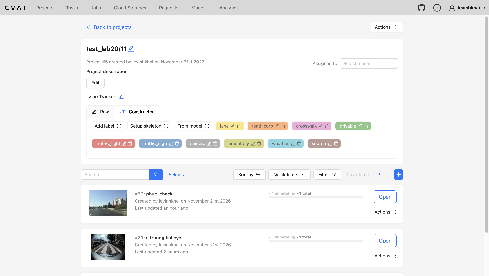
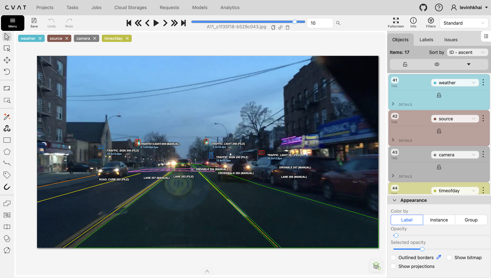
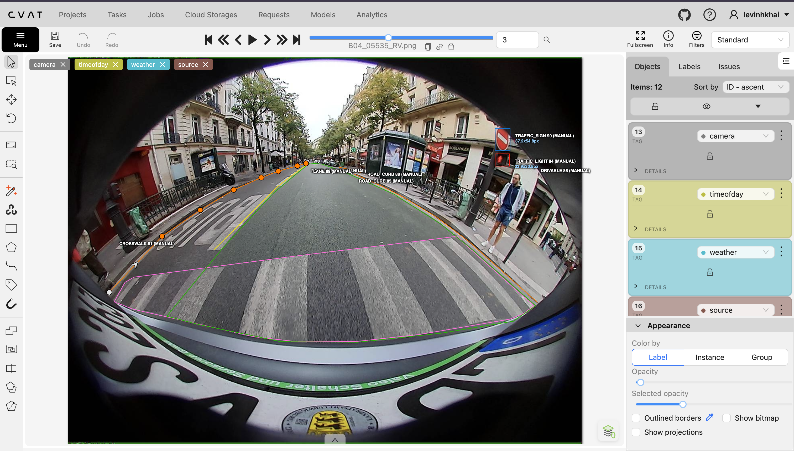
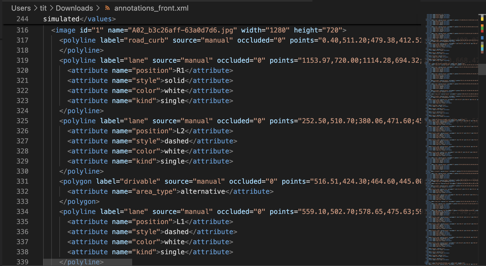

# Báo cáo cá nhân — Ngày 11
Họ tên: Lê Vĩnh Khải
Mã học viên: 2A202603322
Phiên bản CVAT (Help → About): 2.81.0
Guideline: Road v1.0
Lần nộp (`revision` trong manifest): 1
Thời điểm export (ngày giờ trên CVAT): 21:00 20/11/2026
Số lần nộp lại sau Rework: 0 

## 1. Kiểm project
| Mục | Đúng như guideline Road v1.0? | Ghi chú |
| --- | --- | --- |
| 6 label, đúng kiểu | Có — đã đối chiếu cấu hình và hai ZIP cuối | `lane`, `road_curb`: polyline; `crosswalk`, `drivable`: polygon; `traffic_light`, `traffic_sign`: rectangle. Export có đủ 6 label và đúng kiểu shape. |
| Thuộc tính và giá trị | Có — khớp Road v1.0 | `lane`: position = L1/R1/L2/R2/other, style = solid/dashed, color = white/yellow/other, kind = single/double; `drivable`: area_type = direct/alternative; `traffic_light`: color = red/yellow/green/off/unknown, type = vehicle/pedestrian/beacon, facing = front/side/back, edge_zone = true/false; `traffic_sign`: group = prohibitory/mandatory/warning/information/supplementary/other, facing = front/side/back, edge_zone = true/false. `road_curb` và `crosswalk` không có thuộc tính; `occluded` là cờ có sẵn của CVAT. |
| 4 tag ảnh | Có — XML xác nhận đủ trên 20/20 ảnh | `camera`: front/fisheye_front/fisheye_rear/fisheye_left/fisheye_right; `timeofday`: day/dusk/night; `weather`: clear/overcast/rain/fog/other; `source`: real/simulated. Mỗi tag có một thuộc tính select tên `value`. |
Cách kết thúc polyline trên bản CVAT này: Nhấn phím N sau khi đặt các điểm điều khiển từ gần xe ra xa.  
Cách đặt tag ảnh trên bản CVAT này: Chọn công cụ Tag trên thanh công cụ bên trái, chọn label tương ứng và tạo tag. Sau đó kiểm tra và điều chỉnh thuộc tính value trong bảng Objects. Thực hiện lần lượt camera, timeofday, weather và source..  

## 2. Số lượng đã gán
| Task | Ảnh | lane | road_curb | crosswalk | drivable | traffic_light | traffic_sign |
| --- | ---: | ---: | ---: | ---: | ---: | ---: | ---: |
| front | 12 | 44 | 30 | 11 | 27 | 49 | 76 |
| front-extra (đã làm 0 / 4) | 0 | 0 | 0 | 0 | 0 | 0 | 0 |
| fisheye | 8 | 12 | 28 | 15 | 12 | 17 | 16 |
| fisheye-extra (đã làm 0 / 4) | 0 | 0 | 0 | 0 | 0 | 0 | 0 |

## 3. Bảng ca khó
| Ảnh | Nhãn | Phân vân giữa | Đã chọn | Lý do |
| --- | --- | --- | --- | --- |
| A07 | drivable | Gán hoặc không gán drivable cho phần mặt đường nằm giữa hai vùng drivable hiện có. | Không gán drivable cho phần ở giữa. | Khu vực này là vùng phân cách giữa các làn xe, không phải làn đường dành cho phương tiện lưu thông thông thường. |
| A10 | drivable | Có nên gán drivable cho phần mặt đường nằm giữa hai vạch trắng phân cách hay không. | Không gán drivable cho khu vực giữa hai vạch trắng. | Khu vực này không tạo thành một làn xe độc lập. Việc gán thêm drivable có thể khiến phạm vi vùng lái không phản ánh đúng chức năng của mặt đường. |
| A01 | drivable | Có nên gán area_type = alternative cho phần mặt đường nằm giữa vạch vàng liền ngoài cùng bên phải và hộ lan hay không, vì phương tiện có thể di chuyển vào đó trong tình huống khẩn cấp. | Không gán drivable cho phần lề đường bên ngoài vạch liền. | Mặc dù phương tiện có thể đi vào khu vực này trong tình huống khẩn cấp, đây không phải là làn xe cùng chiều dành cho lưu thông thông thường. Theo Guideline Road v1.0, vùng alternative không bao gồm lề đường. |
| B07 | drivable (direct) | Gán toàn bộ vùng làn xe đang đi, bao gồm thân xe chứa camera, hoặc chỉ gán phần mặt đường còn nhìn thấy. | Chỉ gán phần mặt đường, loại trừ thân xe. | Theo guideline Road v1.0, vùng drivable không bao gồm thân xe chứa camera. |

## 4. Phiếu QC 1 nhận được
Bạn kiểm lô của tôi: Võ Văn Long 
Quyết định nhận được: Release 

| Mã lỗi | Số lỗi | Đồng ý? | Đã sửa? |
| --- | ---: | --- | --- |
| QC1-09 | 5 | Có | Có |

Lỗi ghi nhận: Một số nhãn traffic_sign chưa được kiểm tra và điều chỉnh thuộc tính phù hợp, dẫn đến việc giữ nguyên giá trị mặc định không chính xác.

Cách khắc phục: Đã rà soát và điều chỉnh các thuộc tính group, facing và edge_zone của những biển báo được ghi nhận lỗi, bảo đảm phù hợp với Guideline Road v1.0.

## 5. Kiểm file export
| File | Mở lại được? | Số shape ảnh 1 (job / file) | Số shape ảnh 2 (job / file) | Tag camera có trong XML? |
| --- | --- | --- | --- | --- |
| levinhkhai-front.zip | Có | 12 / 12 | 9 / 9 | Có |
| levinhkhai-fisheye.zip | Có | 7 / 7 | 22 / 22 | Có |

## 6. Ảnh chụp màn hình

### 1. Tab Labels của project

### 2. Một ảnh camera trước đã gán đủ

### 3. Một ảnh fisheye đã gán, phóng to đoạn polyline cong

### 4. Một đoạn XML có polyline label="lane"

## 7. Tự đánh giá

Lỗi bạn mắc nhiều nhất hôm nay (theo mã QC1-xx), và cách tránh ở Ngày 20: 

Lỗi mắc nhiều nhất là QC1-09 (sai thuộc tính biển báo). Trong quá trình gán nhãn traffic_sign, tôi thường tập trung vào việc vẽ bounding box mà quên kiểm tra và điều chỉnh các thuộc tính group, facing và edge_zone, dẫn đến một số nhãn giữ nguyên giá trị mặc định chưa phù hợp. Để tránh lỗi này ở Ngày 20, tôi sẽ kiểm tra đầy đủ thuộc tính ngay sau khi gán mỗi đối tượng và thực hiện self-QC trước khi export.

Nhãn của bạn đi vào model ở đâu? Chọn một lỗi đã sửa và nói nó làm model học sai thế nào:

Các nhãn được sử dụng làm ground truth trong quá trình huấn luyện mô hình học có giám sát (Supervised Learning). Bounding box giúp mô hình học vị trí của biển báo, còn các thuộc tính giúp mô hình học cách phân loại và nhận biết đặc điểm của biển báo.

Ví dụ, lỗi gán nhầm thuộc tính group của biển chỉ dẫn từ information thành prohibitory khiến mô hình học sai mối liên hệ giữa đặc điểm hình ảnh và chức năng của biển báo. Điều này có thể dẫn đến việc mô hình phân loại nhầm biển chỉ dẫn thành biển cấm khi triển khai thực tế, ảnh hưởng đến độ chính xác và an toàn của hệ thống hỗ trợ lái xe. Việc sửa lại thuộc tính giúp cung cấp dữ liệu huấn luyện chính xác hơn cho mô hình.

## 8. (Tùy chọn, buffer) Từ polyline đến đích row-anchor

Ảnh kiểm tra: A01
Vạch được chọn: R1

| y | 720 | 680 | 640 | 600 | 560 |
| --- | ---: | ---: | ---: | ---: | ---: |
| x của chúng tôi | không có làn | không có làn | 596.9 | 541.1 | 485.3 |
| x của bạn kia | không có làn | 613.0 | 564.7 | 517.0 | 468.4 |

Sử dụng polyline R1 được gán thủ công của bạn được kiểm để đối chiếu, do ảnh A01 có nhiều polyline R1 chồng lặp.

Trả lời 3 câu:

1. Năm số x đó chính là đích mà một model row-anchor học cho vạch này. Nếu bạn dừng polyline sớm 40 px, hàng nào đổi thành "không có làn"?

   Trả lời: Polyline R1 của tôi có điểm kết thúc ở y = 512.60. Nếu dừng sớm 40 px theo trục y, điểm kết thúc mới là y = 552.60. Vì vậy, không có hàng anchor nào đang có làn chuyển thành "không có làn". Hai hàng 720 và 680 vốn đã không có làn.

2. So với bạn được kiểm (cùng ảnh): ở hàng 720 và hàng 560, hai bạn lệch nhau bao nhiêu pixel? Lệch ở hàng nào ảnh hưởng LKA nhiều hơn (slide 25)?

   Trả lời: Tại hàng 720, cả hai polyline đều không cắt qua hàng này nên không thể tính độ lệch pixel. Tại hàng 560, độ lệch là |485.3 - 468.4| = 16.9 px. Về nguyên tắc, sai lệch tại hàng 720 có ảnh hưởng lớn hơn đến LKA vì đây là vùng gần xe, có ảnh hưởng trực tiếp đến việc xác định vị trí xe trong làn và điều chỉnh hướng lái.

3. Nếu polyline vẽ từ xa về gần (ngược quy tắc 2), cách tính trên có đổi không? Script nào sẽ gặp khó?

   Trả lời: Nếu đảo thứ tự các điểm polyline từ xa về gần, kết quả nội suy row-anchor không thay đổi đối với vạch có một giao điểm tại mỗi hàng. Tuy nhiên, script road_check sẽ phát hiện lỗi QC1-04 do vẽ ngược chiều quy định. Việc xác định điểm đầu gần xe và điểm kết thúc ở xa cũng sẽ bị đảo ngược.